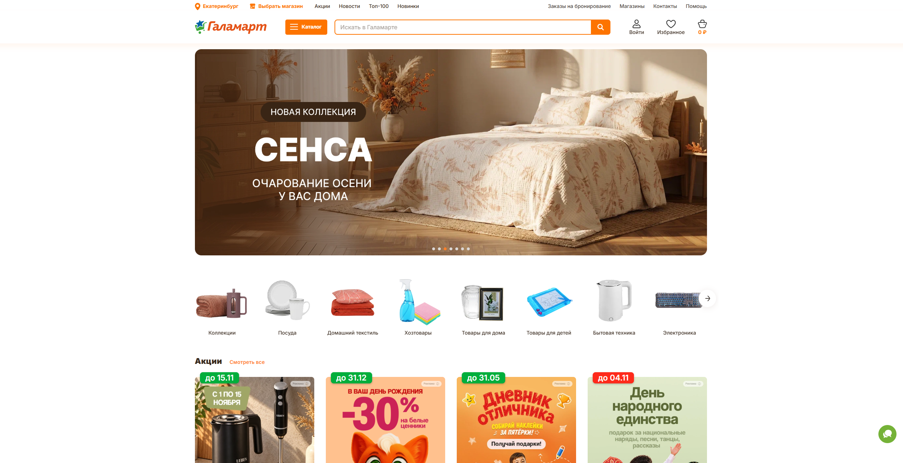
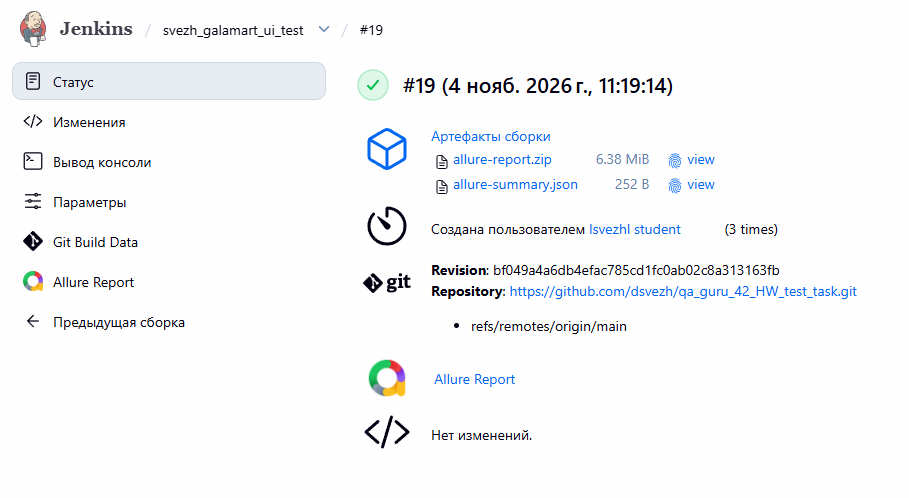
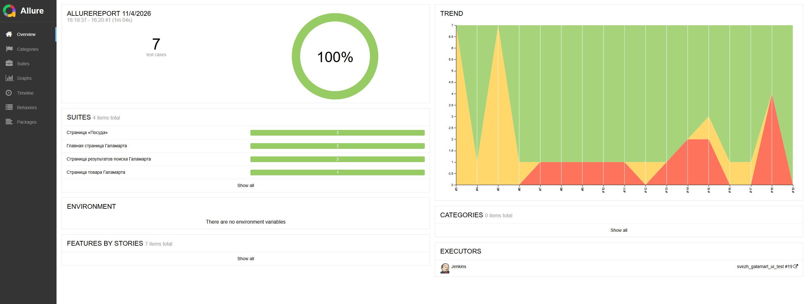
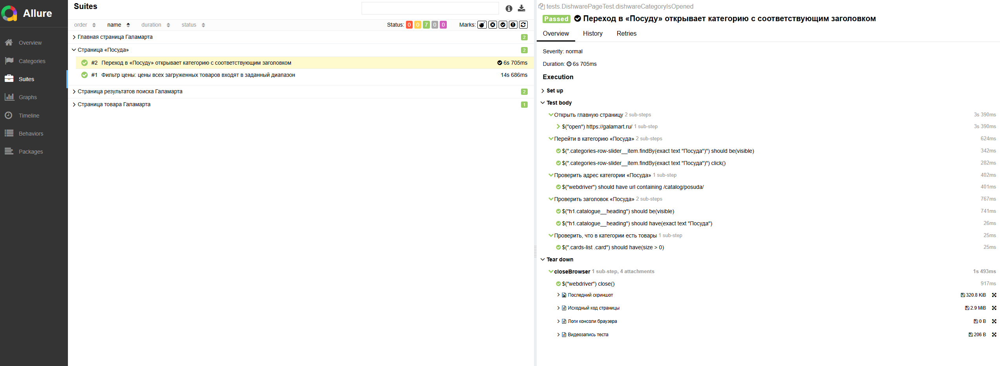
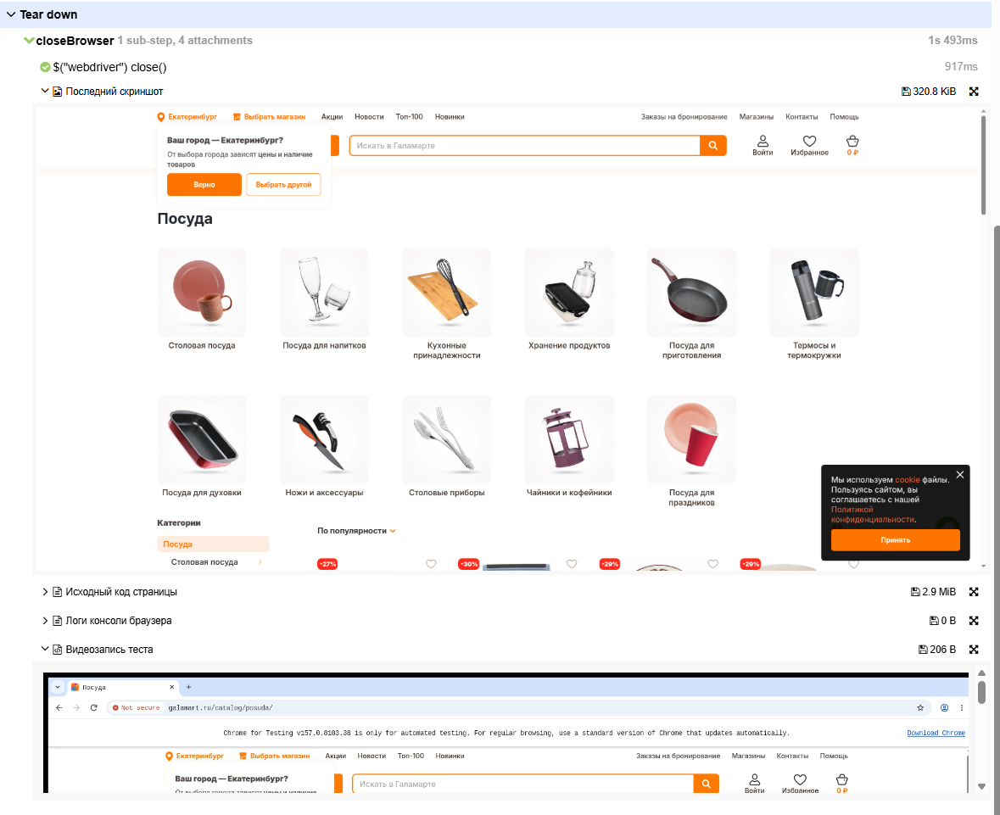
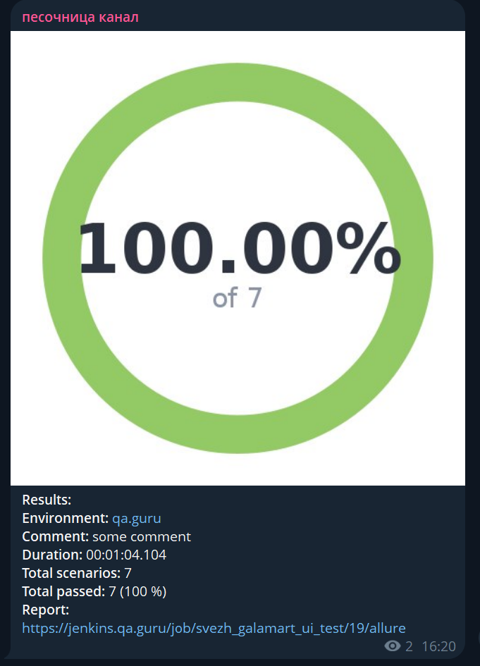

# Автоматизация UI-тестов интернет-магазина Галамарт



> Проект содержит автоматизированные UI-тесты интернет-магазина **[Галамарт](https://galamart.ru)**: проверку главной страницы, выбора города, поиска, категории «Посуда», фильтра цены и карточки товара.

Взаимодействия со страницами вынесены в Page Object и переиспользуемые компоненты.

## 🛠 Технологический стек

<p align="center">
  
  
  
  
  
  
  
  
  
</p>

Тесты написаны на **Java** в среде **IntelliJ IDEA** с использованием фреймворка **Selenide** и тестового движка **JUnit 5**.

- Сборщик проектов — **Gradle**.
- Проект размещён и ведётся в **GitHub**.
- Для удалённого запуска тестов используется **Selenoid** (Chrome).
- Отчётность о результатах тестирования формируется в **Allure Report**.
- Непрерывная интеграция (CI/CD) настроена в **Jenkins**.
- Автоматические уведомления о результатах сборки отправляются в **Telegram**.

## 📋 Покрытый функционал (Тест-кейсы)

В проекте автоматизированы **7 пользовательских сценариев** интернет-магазина **Галамарт**:

- 🏠 **1. Главная страница** — проверка доступности поиска, кнопки «Каталог», разделов «Акции», «Новинки», «ТОП-100 товаров» и ссылки «Посуда».
- 📍 **2. Выбор города** — выбор другого города и проверка его отображения в шапке, в том числе после обновления страницы.
- 🔎 **3. Поиск существующего товара** — поиск выбранного в каталоге товара по артикулу и проверка совпадения названия и ссылки в выдаче.
- ❌ **4. Поиск несуществующего товара** — проверка сообщения «По такому запросу ничего не найдено», отображения введённого запроса и отсутствия карточек товаров.
- 🍽️ **5. Категория «Посуда»** — переход в категорию и проверка её адреса, заголовка и наличия товаров.
- 💰 **6. Фильтрация по цене** — установка диапазона **100–500 ₽**, проверка применения обеих границ фильтра и цен всех загруженных товаров.
- 🏷️ **7. Карточка товара** — открытие выбранного в каталоге товара и проверка его адреса, названия и артикула.

## 💻 Запуск тестов из терминала

### Локальный запуск всех тестов

```powershell
.\gradlew.bat clean test
```

### Запуск отдельного теста

Пример для сценария фильтрации по цене:

```powershell
.\gradlew.bat test --tests "tests.CatalogPageTest.pricesAreWithinSelectedRange"
```

### Запуск тестового класса

Пример для всех сценариев поиска:

```powershell
.\gradlew.bat test --tests "tests.SearchPageTest"
```

### Параметры запуска

Параметры передаются через `-Dимя=значение`:

| Параметр | По умолчанию | Назначение |
|---|---|---|
| `baseUrl` | `https://galamart.ru` | Адрес сайта |
| `selenide.browser` | `chrome` | Браузер |
| `browserVersion` | Не задана | Версия браузера; при удалённом запуске должна быть доступна в Selenoid |
| `browserSize` | `1920x1080` | Размер окна браузера |
| `remoteUrl` | Не задан | Адрес WebDriver в Selenoid; без параметра запуск локальный |
| `videoUrl` | `https://selenoid.qa.guru/video/` | Базовый адрес видеозаписей Selenoid |

```powershell
.\gradlew.bat test "-DbaseUrl=https://galamart.ru" "-Dselenide.browser=chrome"
```

### Удалённый запуск через Selenoid

Нужен доступ к работающему серверу **Selenoid** с доступным браузером и настроенной записью видео. Параметр `remoteUrl` переключает тесты на удалённый запуск.

Пример для сервера QA Guru; если сервер требует авторизации, укажите свои данные подключения:

```powershell
.\gradlew.bat clean test "-DremoteUrl=https://selenoid.qa.guru/wd/hub"
```

## 🗂 Структура проекта

Проект построен по паттерну **Page Object**: действия и проверки страниц вынесены в классы `pages`, а общие элементы интерфейса — в переиспользуемые компоненты `components`.

```text
src/test/
    java/
        tests/          # 7 тестов в 4 классах и общая настройка TestBase
        pages/          # Page Object главной, поиска, категории и товара
        components/     # Поиск и список товаров
        models/         # SelectedProduct: название, ссылка и артикул
        helpers/        # Attach: вложения Allure
    resources/
        allure.properties
```

Тесты сгруппированы по страницам: `MainPageTest` — главная страница, `SearchPageTest` — поиск, `CatalogPageTest` — категория "Посуда" и фильтр цены, `ProductPageTest` — карточка товара. Класс `TestBase` настраивает браузер и собирает вложения перед закрытием сессии.

Компоненты `SearchComponent` и `ProductListComponent` отвечают за поиск и работу со списком товаров. Модель `SelectedProduct` хранит данные выбранного товара, а помощник `Attach` формирует вложения Allure.

## 📊 Отчётность в Allure Report

**Allure Report** содержит результаты тестов, шаги выполнения на русском языке и вложения для анализа прогона.

### Генерация и просмотр отчёта локально

Запустить тесты и сформировать отчёт:

```powershell
.\gradlew.bat clean test
```

После `test` автоматически выполняется `allureReport`, в том числе при падении тестов. Команда `clean` удаляет результаты предыдущих запусков.

Открыть отчёт в браузере через локальный сервер:

```powershell
.\gradlew.bat allureServe
```

Для остановки сервера нажмите `Ctrl+C`. Allure CLI скачивается Gradle автоматически — устанавливать его отдельно не требуется.

Повторно сформировать отчёт по сохранённым результатам:

```powershell
.\gradlew.bat allureReport
```

### Интеграция с Jenkins

На странице сборки **Jenkins** доступны ссылка на **Allure Report** и артефакты отчёта. Ниже показана успешная сборка проекта:



### Общая статистика

На странице **Overview** отображаются количество тестов, их статусы и общая статистика запуска.



### 🔍 Детализация тест-кейса

В карточке теста отображаются шаги открытия страниц, действий пользователя и проверок. Шаги описаны на русском языке с помощью `Allure.step`.



### 📎 Вложения и логи

После каждого теста, если браузер был запущен, автоматически прикрепляются:

- **Screenshot** — скриншот финального состояния страницы.
- **Page Source** — исходный код страницы.
- **Console Logs** — логи консоли браузера.
- **Video** — видеоплеер со ссылкой на запись при удалённом запуске через Selenoid.

Вложения собираются и для успешных, и для упавших тестов. Видеозапись хранится на сервере Selenoid; при локальном запуске видео не записывается.



<details>
<summary>Файлы отчётов и особенности сбора вложений</summary>

| Результат | Путь |
|---|---|
| Данные Allure | `build/allure-results/` |
| HTML-отчёт Allure | `build/reports/allure-report/allureReport/index.html` |
| HTML-отчёт Gradle | `build/reports/tests/test/index.html` |
| JUnit XML | `build/test-results/test/` |
| Скриншоты и HTML Selenide при падении | `build/reports/tests/` |

Вложения собираются до закрытия браузера. Если получить отдельное вложение не удалось, в отчёт добавляется описание ошибки, а сбор остальных продолжается. Allure Selenide дополнительно прикрепляет скриншот и HTML страницы при ошибках.

Видео становится доступно после закрытия браузерной сессии и обработки записи на сервере Selenoid. Сам MP4-файл в отчёт не копируется.

</details>

## 📬 Уведомления в Telegram

После завершения сборки в **Jenkins** бот автоматически отправляет в **Telegram** сводку результатов тестирования:

- Диаграмму с долей успешно пройденных тестов.
- Окружение и продолжительность запуска.
- Общее количество сценариев и количество успешно пройденных тестов.
- Ссылку на **Allure Report**.



## 🎥 Запись выполнения теста в Selenoid

При удалённом запуске **Selenoid** записывает выполнение теста в браузере. Запись доступна в карточке теста **Allure Report** во вложении **«Видеозапись теста»**.

Ниже показано прохождение сценария **«Фильтрация по цене»**: переход в категорию «Посуда» и установка диапазона **100–500 ₽**.


